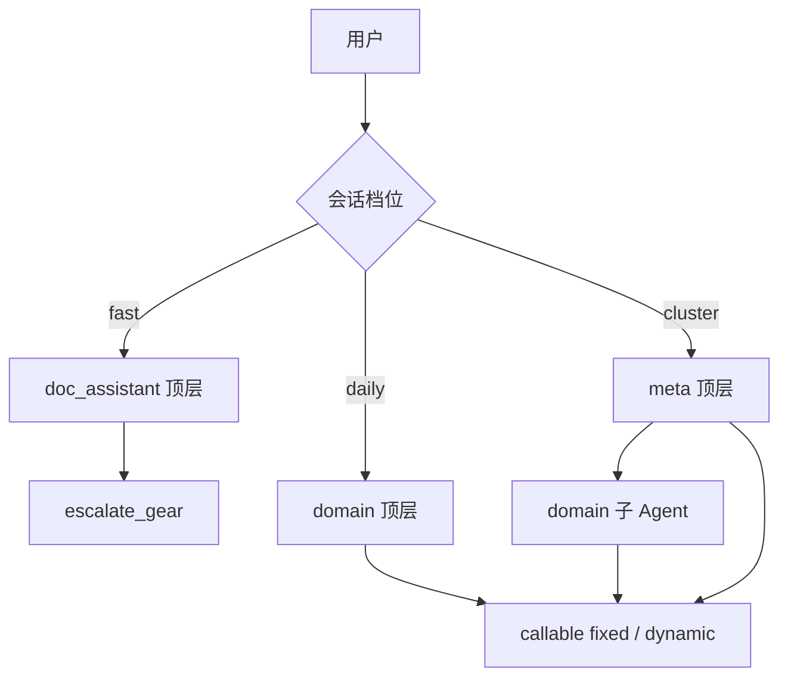
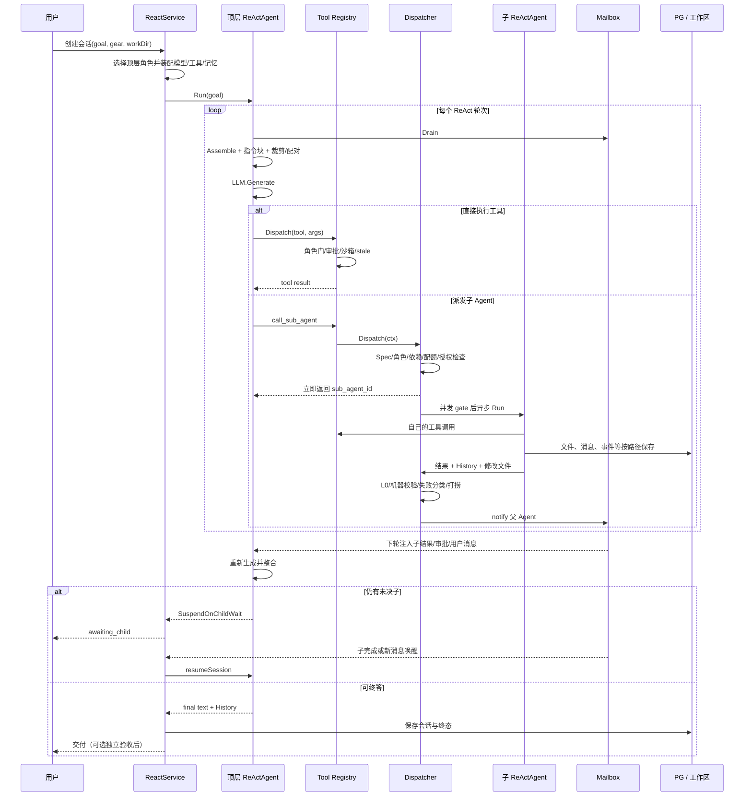

# 21 多 Agent 设计详解

> 本章按 2026-11-03 核对的当前代码与配置，完整还原普通会话的多 Agent 主链：角色与三档、ReAct、递归派发、工具权限、上下文与记忆、计划审批、Mailbox、验收、暂停恢复和持久化。
>
> 代码路径均相对仓库根目录；定位以函数／符号名为准，不依赖易漂移行号。事实冲突时优先级为：当前代码与配置 > 本章 > 02–06 等旧章及历史设计稿。Goal／Loop、Flow、Workflow 不是本章的普通会话子 Agent 主链，分别见 [18 Goal 指令与 Flow 流程](18-Goal指令与Flow流程.md)、[19 工作流量产流水线](19-工作流量产流水线.md)。
>
> 验证边界：本章是静态代码与配置还原，未执行 Go 构建或测试。

## 21.1 一句话架构与关键结论

普通会话不是“一个总 Agent 同步调用若干函数”，而是：

```text
ReactService 管理会话
  → 顶层 ReActAgent 持有独立消息历史
  → 模型通过工具行动
  → call_sub_agent 由 Dispatcher 异步建立子 ReActAgent
  → 子 Agent 拥有独立角色、模型、工具面、记忆事件与生命周期
  → 结果经 Mailbox 回灌父 Agent
  → 父 Agent 再生成，整合为最终答复
```

理解当前实现，先固定以下结论：

1. **三档决定顶层角色，不是三个不同 ReAct 实现**：`fast=doc_assistant`、`daily=domain`、`cluster=meta`。
2. **主树是 meta → domain → 叶子**；daily 允许顶层 domain 直接执行或下拆叶子，fast 不进入子 Agent 等待链。
3. **父 Agent 不读取子 Agent 的完整内心历史**：通常只消费子 Agent 回传的摘要、结构化校验结果和文件清单。
4. **“看得到工具”与“允许执行工具”是两道门**：Schema 过滤之外，还有 Registry 执行硬门、派发级授权、沙箱和审批。
5. **History、MemoryEvent、共享 KV／Spec、决策账本、长期记忆是不同载体**，不能统称成一份“记忆”。
6. **压缩修改的是请求视图，不是把权威 History 直接摘要化**；但权威 History 本身也会对超长工具入参／输出做截断或全文外置。
7. **计划有两套**：`write_plan` 是机器看板；`submit_plan/review_plan` 是逐级审批。后者当前有 600 秒超时 fail-open，不是绝对的人审硬保证。
8. **验收也有两层**：子任务完成时的自动机器校验，与可选的顶层独立测试助手验收。后者默认关闭。
9. **子 Agent 不直接继承父工具调用的 cancel**：它们以会话 `stopCtx` 为中断基底；显式停止可级联，普通 pause 不等同全树取消。
10. **源码注释存在历史漂移**：例如“Meta 只派发不执行”“Domain 只见 call_sub_agent”“父取消不影响任何子 Agent”均不能代表当前完整行为。

## 21.2 核心对象、身份与职责边界

| 对象 | 主要代码 | 当前职责 |
|---|---|---|
| `ReactService` | `backend/internal/agent/service_react.go` | 会话创建、发送、续跑、顶层 Agent 装配、状态、事件与恢复 |
| `ReActAgent` | `backend/internal/agent/react_agent.go` | 单个角色的 LLM → 工具 → 结果循环，拥有独立 History 与 MemoryPipeline |
| `role.Registry` | `backend/internal/domain/role/registry.go` | 合成 meta／domain，查询 fixed／dynamic 角色，判断角色调用关系 |
| `subagent.Dispatcher` | `backend/internal/domain/subagent/dispatcher.go` | 派前校验、异步执行、树、并发、失败、验收、暂停恢复与热驻 |
| `tool.Registry` | `backend/internal/domain/tool/registry.go` | 工具注册、Schema、Dispatch、角色硬门及执行守卫 |
| `ToolRegistryAdapter` | `backend/internal/agent/tool_adapter.go` | 为某个 Agent 计算工具暴露面并转入统一 Dispatch |
| `memory.Pipeline` | `backend/internal/domain/memory/pipeline.go` | MemoryEvent、请求视图压缩、文件地图与压缩状态恢复 |
| `Mailbox` | `backend/internal/mailbox/mailbox.go` | 定向异步消息、问答、优先级 Drain、未读恢复与死信 |
| `orchestrator.Tree` | `backend/internal/domain/orchestrator` | Agent 层级、节点状态与取消句柄等运行拓扑 |
| `board.TaskBoard` | `backend/internal/board` | 计划任务、依赖、负责人和执行状态；不是 Agent 树 |

### 三种 ID 不要混用

- `roleID`：逻辑角色，如 `meta`、`domain`、`code_assistant`。
- `sessionID`：会话与顶层 Agent 的标识。新格式为 `session-<bootEpoch>-<bootRand>-<seq>`，见 `session_react.go` 的 `createSession`；不再是单纯的 `session-N`。
- `agentID`：Agent 实例标识。顶层为 `sessionID`；子实例为 `<parentAgentID>/<roleID>-<全局序号>`，由 `Dispatcher.dispatchOne` 生成。

`agentID` 的层级编码用于找父、找会话和运行时身份展示，但**从字符串反推 roleID 并不是所有路径都等价于构造时的真实角色**，daily 的边界见 §21.21。

## 21.3 三档、顶层角色与模型选择

| 档位 | 顶层角色 | 主要行为 | 子 Agent 等待保护 | 上下文引擎 |
|---|---|---|---|---|
| `fast` | `doc_assistant` | 文档／轻任务直达；可通过 `escalate_gear` 请求升档 | 不接未决子检查，不启用顶层等子挂起 | fast trim：旧工具输出 stub，零 LLM 压缩 |
| `daily` | `domain` | 默认直接执行；值得时才下拆叶子 | 接未决子、暂停子检查与 `SuspendOnChildWait` | daily safeguard：默认 LLM 摘要金字塔 |
| `cluster` | `meta` | 完整编排、直接工具执行、派发与汇总 | 同上 | cluster DAG：更早阈值与分层摘要 DAG |

当前 `agent.default_gear: daily`。选档是手动会话配置，旧 `auto` 仅作读侧兼容并映射为 `daily`，不是仍在运行的自动路由器。

### 顶层装配差异

`runSession` 与 `resumeSession` 都会按当前档位重新构造顶层 Agent，接入：

- 角色模型与运行时 `providerFunc`，支持下一次调用前热切换；
- 角色工具 adapter、Mailbox、MemoryPipeline、LoopConfig；
- 工作目录、人格、项目上下文、技能块、记忆索引；
- 会话指令块、自进化准则、消息日志、LiveEvents；
- daily／cluster 的未决子检查、暂停子检查与等子挂起。

**只有顶层 `meta`** 额外包装任务看板、空闲 Domain 名册和任务台账上下文。daily 顶层虽然 roleID 是 domain，也不会因此自动得到 cluster 的完整编排上下文。

思考强度和模型覆盖属于会话／角色运行时维度，不等于再创建一种 Agent。切档或换模型后，续跑时按新配置重建顶层执行体；已有会话历史和持久化元数据按各自路径恢复。

## 21.4 角色树与合法调用图



`role.Registry.CanCall` 在 Dispatcher 主链中的实际规则是：

| 调用方 | 允许目标 | 拒绝目标 |
|---|---|---|
| `meta` | `domain`，以及 `CanBeCalled=true` 的 fixed／dynamic | `meta` 自身及不可调用角色 |
| `domain` | `CanBeCalled=true` 的 fixed／dynamic | `domain→domain`、`domain→meta` |
| fixed | 代码进入 fixed 分支后，检查其 `Parents` 中是否含目标 roleID | 未列入者 |

当前 fixed 叶子的基础工具白名单均不含 `call_sub_agent`，所以常规执行树到叶子为止。派发级 `tools` 授权可以改变有效工具面，但不会取消 `CanCall` 检查。

动态角色由 `Registry.Register` 接收，必须满足：

- `Type=dynamic`；
- 非空 `SystemPrompt`；
- ID 不与现有角色冲突；
- 不能覆盖保留的 `meta`／`domain`。

### 当前固定角色

| roleID | 定位 | Spec 豁免 |
|---|---|---|
| `scout` | 只读侦察、定位与检索 | 是 |
| `light` | 小范围查修一体 | 是 |
| `code_assistant` | 代码实现 | 否 |
| `ui_assistant` | UI／前端实现 | 否 |
| `prompt_reviewer` | 提示词审查与优化 | 否 |
| `code_reviewer` | 只读代码审查、结构化 findings | 是 |
| `test_assistant` | 测试与验收，可写测试产物 | 是 |
| `doc_assistant` | 文档任务；也是 fast 顶层角色 | 否 |

**`parents` 的配置口径有实现偏差。** `create_role` 工具描述把被调角色的 `parents` 说成“允许哪些父角色调用”，`scout/light` 也配置了 `[meta, domain]`；但当前 `role.Registry.CanCall` 的 meta／domain 分支只检查目标的 `CanBeCalled`，没有读取目标的 `Parents`。因此，不能把这两个 YAML 字段描述成当前 Dispatcher 已经强制执行的父级白名单。

## 21.5 创建、发送、续跑与终答

### 新会话

1. 入口调用 `ReactService.CreateSession`，生成会话并保存目标、工作目录、gear、thinking、model 等元数据。
2. `runSession` 按 gear 选角色，建立模型、工具、记忆、事件与工作目录绑定。
3. 顶层 `ReActAgent.Run` 从用户目标启动，逐轮生成或调用工具。
4. 纯文本不必然是终答：还要通过 Mailbox 竞态处理和未决子检查。
5. 最终由 ReactService 落会话状态、历史与事件，并触发相应指令／演化钩子。

### 运行中收到新用户消息

- 若顶层 ReAct 正在运行，新消息投入顶层 Mailbox，下一生成点消费，**不另起一个并发 ReAct 主循环**。
- 若处于 `awaiting_child` 等非运行等待态，则由会话服务唤醒并重建上下文续跑。
- 新用户任务会清理 ReadFile 连读计数、重置会话派发总数，并重新武装 Domain Idle TTL 等相关状态。

### 等待用户答复时

`ask_user`、批量问答和工具破坏性审批使用各自的答复通道。用户提交答案后应完成原工具等待或审批，而不是把答案当成一个全新任务再启动第二个 ReAct 循环。

### 等子 Agent 时

- 顶层 meta／domain：返回 `SuspendOnChildWait`，会话进入 `awaiting_child`；子完成、Mailbox 新消息或用户消息可唤醒。
- Dispatcher 创建的子 Agent：不开顶层挂起语义；有自己的未决子时仍阻塞等待，避免把“已派发、尚未整合”的中间文本当成子任务最终交付。

Goal／Loop 会在回合结束后再决定是否续跑，不是 ReAct 内部另一条隐形循环，详见 [18 Goal 指令与 Flow 流程](18-Goal指令与Flow流程.md)。

## 21.6 ReAct 单轮的完整顺序

`ReActAgent.RunWithHistory` 的核心可以概括为以下伪代码；它描述顺序，不是可直接编译的源码拷贝：

```text
把本次用户输入追加到 canonical History
构建本 run 的系统提示
while 未达到 maxIter（maxIter <= 0 时不限轮）：
    若热驻 suspendGate 存在，先处理挂起
    drain Mailbox；新邮件作为后续上下文输入
    messages = MemoryPipeline.Assemble(role, agentID, History)
    仅在请求视图驱逐过旧的只读工具结果
    尾部追加会话指令块（顶层为决策账本 + 长期记忆）
    尾部追加当前时间
    按消息数窗口裁剪，修复 assistant/tool 配对
    若当前模型不支持视觉，在请求视图剥图
    子 Agent 若仍超过上下文 token 阈值，返回 LimitReached
    LLM.Generate(system prompt + messages + tools.Schema())

    若工具参数 JSON 非法：纠偏重试，连续超阈值则报错
    若响应为空：逐级缩窗、剥图并纠偏，连续超阈值则报错
    把 assistant 消息写入 History（超长工具入参按历史上限截断）

    若没有 tool_calls：
        再 drain Mailbox；有新邮件则 continue，重新生成
        若存在暂停子节点，返回 PausedOnChild
        若存在未决子节点：
            顶层返回 SuspendOnChildWait；子 Agent 阻塞等子
        终答前再次 drain，消除完成通知竞态
        写 answer MemoryEvent，返回最终文本与 History

    否则：
        同轮工具可并行执行，同路径写操作互斥
        工具结果按模型原调用顺序串行回填 History
        写工具 MemoryEvent、发事件、再次 drain Mailbox
        更新停滞／重复动作等循环守卫
```

### 关键守卫与“完整历史”的准确含义

- 当前 `tool_call_max_rounds: -1`，不采用旧文档中的默认 50 轮。构造器里的历史默认值不能覆盖已注入的生产配置。
- 子 Agent 连续无产出 10／20／30 轮分别预警、最终通牒、`ErrLoopExit`；顶层不启用这套硬杀。
- `history_max_messages: 400` 是请求窗口兜底，不是压缩触发器；压缩由 token 阈值驱动，`summarize_every` 已退役。
- 单条工具输出超过 8000 runes 时，全文落 `<workDir>/.bma/tool_outputs/`，历史保留 2000 runes 摘录；`tool_output_history_max_runes: 20000` 再约束单条历史输出。
- 超长工具入参也会在写入 History 的副本中截断；完整入参用于当次执行。
- 因此，“完整 History”指**完整的消息结构、工具调用配对与执行轨迹**，不等于所有原始字节永远内嵌保存。全文外置文件又是另一种工作区产物。

## 21.7 派发前门槛与异步启动

### 调用面

`call_sub_agent` 的主要参数包括：

```text
role_id / task / domain / responsibility
mode=react|reflection|plan_execute
verify_kind=auto|executable|rubric|none
tools_hint / skills / tools / tools_mode=only|extend
wall_clock_min / reuse_agent_id / takeover / worktree
```

`call_sub_agents` 用于同波批量，`map_sub_agents` 用于映射并聚合。task 当前软上限 3000 runes、硬上限 4000 runes：软限提示压缩，硬限拒绝，不是旧版固定 2000。

### `dispatchOne` 的主要门槛

1. 从 ctx 取得父 agentID；`reuse_agent_id` 优先进入热驻复用分支。
2. 查目标角色，解析派发级 `tools` 与 `tools_mode`。
3. 做角色任务能力匹配、任务路径适配和可选决策层能力缺口检查。
4. 校验 worktree 开关及互斥条件。
5. 未显式给墙钟时，为 `spec_exempt` 角色设置短预算；light 单独更长。
6. 经 `CanCall` 校验角色关系。
7. 进入按 parentID 分条的 `dispatchStripes` 临界区，避免并行工具下同父同名 Domain 的 TOCTOU。
8. Domain 检查看板依赖、同父同名活跃 Domain、热驻复用建议。
9. 合并前序失败打捞；计算接力代数，必要时要求重写评估或接力理由。
10. 消耗 session 级派发配额，生成子 agentID。
11. 如需 worktree，先创建副本；失败不静默退回主工作区。
12. 挂载 `tools_hint`、登记技能持有集、登记 `tools` 授权。
13. 增加父未决子计数，建立会话中断上下文、树节点、台账和看板状态。
14. 注册活动证据与聚合器，启动 goroutine。
15. 进入全局并发 gate 后才挂实际执行墙钟，最后返回子 agentID 与被忽略的越界授权说明。

### Spec 是派发前硬门

当前 `spec_enforcement_enabled: true`。非 `spec_exempt` 角色在派发前必须能找到新鲜且合法的 Spec：

- 优先读取 `parent:spec:<domain>` keyed 槽位；
- 兼容旧单键和唯一 keyed spec；
- 缺失、非法、过期都可能拒绝；
- worktree 只豁免 stale 限制，不豁免 missing／invalid；
- scout、light、code_reviewer、test_assistant 当前豁免。

Spec 的门禁与计划审批不同：一个回答“任务契约是否明确且新鲜”，另一个回答“执行步骤是否被上级接受”。

### 配额与并发

| 控制 | 当前值／语义 |
|---|---|
| `max_total_dispatches` | 单 session 累计 30；新用户消息重置 |
| `max_concurrent_sub_agents` | 全局同时执行 8；超额 FIFO 排队 |
| 执行墙钟 | 出队后才计时，排队不消耗任务执行预算 |
| 默认子任务墙钟 | 120 分钟；显式 `wall_clock_min` 可覆盖 |
| Spec 豁免角色缺省 | 5 分钟；light 为 10 分钟 |
| 墙钟预警 | 约 50%／75%／90% 投递 Mailbox，极短任务跳过部分档位 |
| 会话总墙钟 | 当前 `session_max_wall_clock_min: 0`，关闭全局上限 |

## 21.8 子 Agent 如何被重新装配

`runSubAgentOnce` 不是把父 Agent 克隆一份，而是按子角色重建执行体：

1. 取角色模型，必要时用领域名覆写展示名。
2. 在 Domain 系统提示尾部追加职责边界；再给 Domain／叶子追加运行时身份与可见拓扑。
3. 包装 MemoryPipeline：维护同级名册变化；Domain 还保留旧黑板摄取兼容路径。
4. 根据角色和 `heldTools` 建工具 adapter。
5. 接 Mailbox、LoopConfig、WorkDir、技能块、自进化准则、项目偏好。
6. 接未决子检查，允许 Domain 再等自己的叶子。
7. 接活动证据、消息热写、会话日志与 LiveEvents。

**子 Agent 不注入顶层的“多 Agent 编排者人格”。** 它的第一身份来自自己的角色提示，避免叶子误以为自己是总编排者。

### 首条任务的装配顺序

```text
项目自述（AGENTS.md 优先，其次 CLAUDE.md）
→ 父级共享 Spec / KV
→ 技能召回提示
→ 旧块记忆召回兼容段
→ Domain 领域标签
→ fork 预算裁剪（超硬顶可丢前缀转 isolated）
→ 当前上下文引擎注记
→ 【当前任务】原始 task
→ executable 校验时追加证据格式要求
```

项目偏好通过 `WithDirectiveBlock` 每轮动态读取，不再冻结进首条 task。子 Agent 的该槽位不是顶层完整的“决策账本 + 用户／项目长期记忆”组合；需要跨 Agent 遵守的任务约束，应通过 task、Spec、共享 KV 或 Mailbox 明确传递，不能假定顶层所有记忆自动广播。

### 中断上下文

子 goroutine 不直接继承一次工具调用的父 ctx。实现优先取会话级 `stopCtx`，再显式重注 sessionID、WorkDir、用户图片等值：

- 显式 Stop／cancel 可沿此基底中断子树；
- 普通工具调用返回不会误杀长任务；
- 不应沿用旧注释得出“父会话取消永远不影响子 Agent”的结论；
- pause 与 cancel 是不同生命周期操作，不能互相推导。

## 21.9 工具权限：从角色到实际执行

### 21.9.1 当前角色静态工具面

以下是基础白名单，不包含“角色可见且已挂载”的插件并集，也不包含后续派发级授权。

**Meta：以 `config/roles.yaml` 非空 `meta_agent.tools` 整体覆盖 Registry 内置默认。**

```text
派发与合并：call_sub_agent, call_sub_agents, map_sub_agents,
            CallExternalAgent, merge_worktree
协作与控制：WriteSharedMemory, ReadSharedMemory, WriteSpec,
            send_message, cancel_agent, pause_agent, resume_agent,
            ask_user, schedule_task, schedule_followup,
            write_plan, submit_plan, review_plan
文件与执行：ReadFile, EditFile, RestoreFile, WriteFile, RunCommand,
            ReadMedia, SearchInFiles, ListDir, ShowArtifact
技能与扩展：list_skills, load_skill, tool_catalog, tool_mount, tool_unmount,
            plugin_search, plugin_install, plugin_enable, plugin_disable,
            plugin_list, tool_forge
模型与记忆：list_models, set_role_model, set_agent_model,
            expand_memory, update_evolution_prompt, search_block_memory
Widget：widget_save, widget_list, widget_push_data, widget_delete, widget_restore
Workflow：workflow_freeze, workflow_run, workflow_status
```

Meta 当前**不含 `HTTPGet`**；联网应经角色可见、已授权并挂载的插件。它也并非“只读／只能派发”，因为文件编辑、命令执行和插件管理均已在有效配置中恢复。

**Domain：`domain_agent` 配置不直接给 tools，使用 `role.Registry.Get("domain")` 的内置清单。**

```text
call_sub_agent, call_sub_agents, map_sub_agents,
ReadFile, ListDir, SearchInFiles, HTTPGet, ReadMedia, ShowArtifact,
WriteSharedMemory, ReadSharedMemory, WriteSpec,
WriteFile, EditFile, RestoreFile, RunCommand, CallExternalAgent,
RefreshProjectDoc, send_message, cancel_agent, ask_user, search_knowledge,
pause_agent, resume_agent, set_agent_model, list_models,
plugin_list, tool_catalog, tool_mount, tool_unmount,
submit_plan, review_plan, list_skills, load_skill,
widget_save, widget_list, widget_push_data, widget_delete, widget_restore,
expand_memory, escalate_gear, update_evolution_prompt, search_block_memory
```

`escalate_gear` 只有 agentID==sessionID 的 daily 顶层才可生效，子 Domain 调用不因此获得升档权。

**Fixed 角色：**

| 角色 | 静态 tools |
|---|---|
| scout | `send_message, ReadFile, ListDir, SearchInFiles, update_evolution_prompt` |
| light | 上述读写执行基础中的 `send_message, ReadFile, ShowArtifact, WriteFile, EditFile, RestoreFile, ListDir, RunCommand, SearchInFiles, GitDiff, GitStatus, load_skill, update_evolution_prompt` |
| code_assistant / ui_assistant / prompt_reviewer | `send_message, ReadFile, ShowArtifact, WriteFile, EditFile, RestoreFile, ListDir, RunCommand, SearchInFiles, HTTPGet, HTTPPost, GitDiff, GitStatus, GitLog, GitBlame, load_skill, update_evolution_prompt` |
| test_assistant | 上一行共同集合，再加 `tool_catalog, tool_mount` |
| doc_assistant | 共同集合，再加 `escalate_gear`；也是 fast 顶层工具面 |
| code_reviewer | `send_message, ReadFile, ListDir, SearchInFiles, GitDiff, GitStatus, GitLog, GitBlame, HTTPGet, load_skill, update_evolution_prompt` |

### 21.9.2 Schema 暴露与执行硬门

```text
角色静态 tools
  ∪（角色可见插件工具 ∩ 当前 agent scope 已挂载）
  → ToolRegistryAdapter.Schema()
  → 模型可选择的工具

角色静态 tools ∪ 角色可见插件工具
  → 再叠加 heldTools 的 only / extend
  → Registry.Dispatch 的角色执行硬门
```

关键区别：

- `role_tool_gate_enabled: true`，模型即使伪造白名单外 tool call，执行时仍可被拒绝。
- 插件挂载主要控制是否向模型暴露；角色可见性是授权天花板，不是“mount 即扩权”。
- 配置预挂载工具有专门放行分支；锻造工具还按 owner scope 隔离。
- 角色 tools 为空在全量语义路径中代表不收窄，不能当成“没有任何权限”。
- adapter 最终仍调用统一 `tool.Registry.Dispatch`，不能只看 Schema 就推断实际安全边界。

### 21.9.3 派发级授权不是简单复制父 Schema

`resolveChildTools` 的规则：

- 内置工具须属于父的可分配集；
- 插件工具还必须对子角色可见；
- 越界项忽略，并随派发结果回告；
- `tools_hint` 是预挂载建议，不等于权限扩大；
- `only` 收窄有效面，`extend` 扩展基础面；
- 授权同时影响子 Schema 与执行硬门，热驻复用沿用槽建立时冻结的授权。

`parentAssignableTools` 对 `meta` 或未声明 tools 的角色给全注册内置工具，**不是严格等于 Meta 当前 YAML Schema 列表**。因此不能写成“父永远只能下放自己模型此刻看得见的内置工具”。

### 21.9.4 Dispatch 内的实际执行顺序

`tool.Registry.Dispatch` 大致按以下顺序处理：

```text
别名解析与注册查找
→ 发 tool_call 事件
→ 角色硬门（含预挂载等既定分支）
→ ReadFile 连读守卫
→ 破坏性操作审批
→ 写入前 stale 检查
→ 工具 Execute
→ 读写后处理
→ validation_rejected 计数
→ 发 tool_result 事件
```

- 同参数 ReadFile：短文件第 3 次、长文件第 6 次触发 `ErrLoopExit`。
- 连续 validation rejection 默认第 5 次终止；Meta 的 `call_sub_agent(s)` 有豁免，成功调用会清对应计数。
- 普通工具执行失败不再按简单失败次数统一连杀。
- 写成功会使引用该文件的共享记忆失效、更新文件地图／mtime，并去抖刷新项目文档。
- 角色拒绝通常作为工具错误回填，让模型修正，不必然立即终止整个 ReAct。

### 21.9.5 信任模式与沙箱是独立层

| trust mode | 文件编辑 | 命令与动态 destructive 工具 |
|---|---|---|
| `suggest` | 需审批 | 需审批 |
| `auto-edit` | 直通 | 需审批 |
| `full-auto` | 直通 | 直通 |

当前默认 `trust_mode: full-auto`，且 `tool_approval_disabled: true`，所以破坏性审批默认直通。**这不关闭角色硬门、写路径沙箱、角色 allowed_write_paths 或命令黑名单。** 生产工作目录还可单独提高写入审批要求。

## 21.10 记忆与上下文：按载体拆开

| 载体 | 作用域与用途 | 主要持久化 |
|---|---|---|
| canonical History | 单 Agent 的 ReAct 消息轨迹与工具配对 | `agent_messages`；主 Agent 与需要恢复的子节点按路径保存 |
| MemoryEvent | 单 Agent 的近期工具、回答、任务等事件流 | `agent_events` |
| 压缩金字塔 | 请求视图中的旧中段摘要包、TailStart、热重注 | `agent_compress_states` |
| 共享 KV／Spec | 同会话父子间传递契约、文件、结论 | `<workDir>/.bma/shared/` |
| 决策账本 | 当前会话的用户指令、路线、否决、审批、验收轴 | `session_decisions` |
| 长期记忆 | 跨会话用户画像与项目经验生命周期 | `long_term_memory_items/events` |
| 旧块记忆／索引 | 兼容检索、展开与旧黑板路径 | `global_knowledge` 等旧数据面 |
| Mailbox | Agent 间待消费通信，不是上下文摘要 | `mailbox_messages` |
| 看板／树／台账 | 计划、拓扑与派发状态，不是模型 History | `session_boards`、`agent_tree_nodes` 及运行台账 |

### 每轮请求上下文的装配顺序

```text
canonical History
→ MemoryPipeline 的分档视图变换与必要的 token 阈值压缩
→ 近期事件、文件地图，以及外层看板／名册／台账等包装段
→ 陈旧只读工具结果驱逐（仅请求副本）
→ 会话指令块：决策账本在前，用户／项目有效长期记忆在后
→ 当前时间
→ 消息数窗口
→ tool pairing 修复
→ 按模型视觉能力剥图
→ system prompt + messages + tools.Schema 发给模型
```

系统提示与消息历史是两条输入：人格、环境／PROJECT／项目自述、角色提示、执行纪律、技能、记忆索引、自进化准则组成系统侧；易变的职责、技能和索引尽量放尾部维护公共前缀缓存。决策、长期记忆、时间则每轮动态注入，不能假定它们存在于 History。

### MemoryEvent 不是 History 的替代品

- 默认近期注入 20 条；超过 8 条可走轻量摘要。
- 摘要不可用时原始拼接最多 4000 runes，防止事件流反向撑爆上下文。
- MemoryEvent 用于“发生了什么”的近期线索；History 用于 ReAct 消息结构与续跑。

### 三档压缩

| 档位 | 触发与保留 | 旧内容处理 |
|---|---|---|
| fast | 沿用上下文预算；保留近期消息 | 保留段之外的旧工具输出超 200 runes 变 stub；压缩不调 LLM |
| daily | token 达角色阈值触发；当前保留最近 15 条 | 旧中段形成 LLM 结构化包；默认最多 20 包，超量合并最老一半 |
| cluster | 候选常驻约 100000 runes 触发，保留活跃段约 30000 | leaf 1200、condensed 2000 runes，fanout 8／merge 4；旧大工具输出 >25000 runes 换约 200 runes 探查摘要 |

本包部分注释以 `tok≈rune` 粗估，不应把上述 rune 数当成 provider 的精确 tokenizer 计数。引擎 panic 或破坏“只换内容、不改消息条数”契约时，QuarantineEngine 记录事件并降级 daily。

`agent_compress_states` 的 `TailStart` 是 History 下标。跨重启恢复该状态，必须能同时恢复同一 Agent 的一致 History；只有摘要包而没有对应消息下标语义，不能声称等价恢复。

### 长期记忆与旧块记忆的当前状态

- `memory.write_mode: shadow`：会话演化可产候选审计，不直接晋升到现行用户画像、项目偏好或技能。
- `memory.retraction_mode: enforce`：明确撤回当轮生效，与 shadow 解耦。
- 有效长期记忆按用户／项目作用域注入，候选、隔离、替换、撤回不进入现行视图。
- 会话启动的沉淀索引从 global knowledge 做目标相关优先、近期补足，过滤 untrusted；当前上限 200 行／25000 runes。它与新长期记忆生命周期不是同一张表。
- `block_memory_write_enabled: false`：子 Agent 完成后不再默认新沉淀块记忆；保留的保存／检索代码不等于写入主链启用。

长期记忆的完整状态机见 [17 长期记忆与决策轴](17-长期记忆与决策轴.md)。

## 21.11 共享 KV、Spec 与一致性

共享记忆位于 `<workDir>/.bma/shared/`，用于会话内协作，不是跨会话长期记忆。

- 普通 KV 带 frontmatter 与 mtime，并支持 CAS 等一致性检查。
- stale 普通 KV 仍可注入，但附失效警告，让模型决定是否重读。
- stale Spec 不注入，保留墓碑；派发时不能把旧契约当新契约。
- `file_tree` 采用单写多读约定，避免多 Agent 同时重写同一全局树。
- 文件写入成功会使相关共享条目失效，推动后续 Agent 重新读取现实文件。
- 父 Spec 在派发时被捕获，供后续冒烟、契约与验收检查；后续 Spec 失效不应抹掉本次派发的验收基准。

这套机制解决的是“多个上下文如何共享同一个任务事实”，不是“所有 Agent 自动看到同一份 History”。

## 21.12 两套计划、审批与 AskUser

### A. `write_plan`：机器看板

- 写入 TaskBoard 的目标和任务列表。
- 校验重复任务 ID、未知依赖和依赖环。
- Domain 派发时，`depends_on` 未完成会硬拒。
- 依赖完成后通知等待方，**不会自动替 Meta 派发下一项**。
- 派发、完成、失败和 plan_execute 步骤均可回写看板状态。

### B. `submit_plan/review_plan`：逐级计划审批

- 顶层提交：上级是用户，复用 `ask_user` 展示计划详情和批准／修改选项。
- 子级提交：向直接父 Agent 发高优先级 Mailbox request，并阻塞等 `review_plan`。
- 只有计划记录中的直接父 Agent 可以审批。
- 驳回后由提交者修订重提；当前 `plan_max_revisions: 0`，不限驳回轮次。
- 当前 `plan_confirmation_enabled: true`，提示词要求子 Agent 动手前先提交计划。

**显著例外：`plan_confirm_timeout_sec: 600`，等待超时、上级不可达或顶层询问通道失败均 fail-open，按计划继续。** 所以“启用计划确认”不等于“任何代码修改都必然经过人审”。

### AskUser 与工具审批不能混同

`ask_user` 是任务澄清／计划等人问答复；破坏性工具审批是执行安全门。二者都可能暂停工具等待用户，但有各自的请求状态和恢复入口。用户回答时应路由到原等待点，而不是重新解释成一项新任务。

## 21.13 Mailbox 与 Agent 间通信

Mailbox 是定向单收件人机制，广播已退役。当前消息类型为：

```text
info / request / reply / escalate / milestone / dependency
```

主要语义：

1. request／escalate 自动补 ThreadID，reply 关联原问题。
2. Drain 按优先级、时间读取未读并标 read；高优先级审批可先于普通摘要。
3. Agent 邮件转成 user 角色消息，带 `[mailbox from …]` 来源。
4. 非 user 来源内容放入 untrusted 围栏，邮件正文不能冒充系统指令。
5. 子完成、失败、部分产出和 worktree 交付均通过通知进入父上下文。
6. `map_sub_agents` 聚合同波结果；批量 digest 失败可回退逐项拼接。
7. 节点终结时 Purge 收件人，后续投递进死信；暂停节点保留邮箱，供续跑 Drain。
8. 持久化 hooks 负责 Save、MarkRead、MarkDead、Restore；重启可重投 PG 中 unread。

**恢复重投不是 exactly-once 消费保证。** 如果崩溃发生在“已消费、尚未标读”等窗口，同一邮件可能再次注入，消费侧需要幂等；`session_events` 的 seq 幂等追加也不能自动证明所有 Mailbox 副作用只执行一次。

`send_message` 另有拓扑可见范围：Domain 可见上级、同级 Domain 与下级叶子；叶子主要可见上级与同组同级，不能任意给全系统 Agent 发信。

## 21.14 三种执行引擎与分层验收

### 执行引擎只包装子 Agent 的循环策略

| mode | 主流程 | 辅助模型失败语义 |
|---|---|---|
| `react` | 直接运行 ReAct | 不需要辅助模型 |
| `reflection` | ReAct 产出后由 judge 按 rubric 检查；不达标带反馈重跑 | judge 不可用且无 L0 证据 → Unverified；有 L0 证据可带警告降级放行 |
| `plan_execute` | 辅助模型出步骤 → 落看板 → 逐步 RunWithHistory → 汇总 | 规划失败、非法 JSON、空步骤 → 整体降级裸 ReAct |

`verify_kind=rubric` 会强制走 ReflectEngine，即使 mode 是 react；`mode=reflection` 也会自动选择 rubric。judge 优先取 `judge_role`（当前 prompt_reviewer）的 provider，取不到才回退被审角色；它是裸 LLM 评审调用，不等于默认再派一个完整测试 Agent。

当前 `reflection_max_rounds: 3`。达到反馈重试上限后返回最近产出，不能把“跑过 reflection”直接解释成“所有 rubric 必然通过”。

`plan_execute_max_steps: 12`，未执行剩余步骤会标 failed，再做收口。其已知边界是各步 RunWithHistory 有独立 token 预算语义，总成本主要由子任务墙钟等外层预算兜底。

### 子任务完成时的自动校验

`verify_kind` 解析规则：

- 显式 executable／rubric／none 优先；
- reflection 自动 rubric；
- auto 下 code_assistant、test_assistant、code_reviewer 为 executable；
- 其他普通 Domain／叶子默认 none，不为每个任务强加同样的校验成本。

executable 的 L0 检查从历史识别实际成功运行的测试、lint、`--check` 等证据：

1. 缺证据，反馈要求补跑一轮；
2. 仍缺，`verify_missing`；
3. 有证据，附 `VerifyNote=L0 证据`。

Domain 收尾还可按 Spec `verify_levels` 做：

- 文件语法 smoke；
- JS／HTML 入口与引用检查；
- integration；
- runtime 探针：导航、断言、console 无错误等；
- visual：截图及场景覆盖；
- 验收条目逐项计分与 quality 缺证据判断。

缺 runtime／visual 等证据，经反馈仍不足时通常走 **delivered-unverified 黄态**，表示“有产出但不能证明”，不是把一切归成真失败。跨域契约违例则是另一类明确问题。

### 顶层独立验收是可选的

`AcceptanceManager.RunWrap` 可在顶层终答前派 `test_assistant` 做整品验收与返工：

- 配置在 `<workDir>/.bma/tester.yaml`，不是全局 config.yaml 的同名字段；
- mode 为 off／auto／on，默认 off；on／auto 才运行；
- 默认最多 2 轮，超限应附【未验证项】交付。

因此，不能写“当前所有任务默认都会经过独立验收 Agent”。普通默认链主要依靠执行者自检、Dispatcher 机器校验和父 Agent 汇总验收。

## 21.15 worktree 隔离与合并门

当前 `worktree_enabled: true`，但它是显式派发选项，不是所有子任务默认隔离。

### 派发与交付

1. `worktree=true` 时要求主目录是 Git 仓库，在 `<repoRoot>/.bma/worktrees/` 建副本和 `bma/` 分支。
2. 子 Agent 的 WorkDir 与工具沙箱基线切到副本。
3. worktree 与 `reuse_agent_id` 互斥；当前热驻开启时不支持热驻 Domain worktree。
4. 成功收尾时 `git add -A`，相对 BaseCommit 生成 cached diff 与 stat，patch 落盘。
5. 创建失败按 validation 拒绝，不静默改派主目录。

### `merge_worktree`

- `review`：返回 diff，工具输出超 20000 runes 截断；完整 patch 可再分段 ReadFile。
- `merge`：检查 base 漂移、触及的契约文件、patch 应用预检；漂移时先在临时索引做三方检查，再走 `git apply --3way`，真冲突拒绝。
- `reject`：修改意见经 Mailbox 回该域；热驻槽存活可续改，已销毁则提示带意见重派。
- 成功后清理副本和分支；会话终态也会 best-effort 清理残留副本，patch 文件保留审计。

这里的主链使用 `git apply`，不是替用户自动创建 Git commit。review 的描述要求先审查再 merge，但代码质量、越界文件等仍需要调用方真正执行审查，不能把工具名称当作独立评审 Agent。

worktree handle 当前保存在 Dispatcher 内存中；磁盘上存在副本／patch，不等于进程重启后合并门句柄也自动持久恢复。

## 21.16 热驻、暂停、恢复与停止

### Domain 热驻

当前开启 Domain hot resident：

| 参数 | 当前值 |
|---|---:|
| 基础 Idle TTL | 10 分钟 |
| 每次复用延长 | 10 分钟 |
| TTL 上限 | 60 分钟 |
| 单 session 热驻槽 | 4 |
| 忙碌 Domain 新任务队列 | 4 |

- Domain 完成后转 Idle，保留执行上下文，等待 `reuse_agent_id`。
- 忙碌时可进入有界任务队列；队列满拒绝，提示稍后重派。
- TTL 到期是冷驻：热 goroutine 销毁，树保留 Idle，可依据持久化历史重建。
- 超过单 session 槽位时按 LRU 淘汰。
- Meta 的空闲名册只展示可复用线索，是否复用由编排逻辑判断；疑似同目标的新建还可能被复用守卫拦一次。
- 热驻复用沿用槽内已冻结的技能和工具授权，不在每次复用时自动重算。

### token 触限与暂停

| 场景 | 结果 |
|---|---|
| Domain 子 Agent 压缩后仍超 token 阈值 | History 落 `agent_messages`，树 Paused；父未决计数保持，等待 resume |
| 顶层 Agent 超 token 阈值 | 不走同一种子 Agent 暂停；仍有窗口与模型错误等兜底 |
| 叶子触限 | 以已有部分产出收口回传，不走 Domain 的同一持久暂停路径 |
| Paused 节点恢复 | 从历史重建角色、工具、记忆与运行上下文，以 fresh budget 续跑 |

`ResumePaused` 的续跑上限当前为 2。Domain 因 token 暂停、恢复达到上限后仍未收敛，会强制部分收口、标 Done 并通知父 Agent，由父决定接手或返工；这不是无限“暂停—刷新预算—再暂停”。

### 手动 pause、软停与硬取消

- 手动 pause 可保留 Domain／叶子历史，之后走通用恢复路径。
- 会话软停止时 Domain 可暂停，叶子按已有部分产出回传。
- 暂停出口不清 Mailbox、不销父未决计数；真正终结才 Purge。
- 显式 stop／cancel 使用会话 stopCtx 级联取消，和热驻挂起、token 暂停不是同一信号。
- 软停止默认还有 300 秒销毁倒计时；未续跑则进入硬销毁。

### 活动证据与卡死处理

子 Agent 上报 LLM、工具、流式输出等活动；后代活动可沿父链冒泡，使“Domain 合法等子”不被误判为自身卡死。辅助 judge／规划在飞也有活动标记。只有超过相应无活动阈值才由巡检取消；墙钟、token 预算和循环守卫分别负责不同失控形态。

## 21.17 失败分类、自动重试与遗产打捞

| failure kind | 含义 | 自动整 Agent 重试 |
|---|---|---|
| `timeout` | 子任务执行墙钟到期 | 否 |
| `error` | 模型、工具或其他通用运行错误 | 仅叶子，当前 1 次 |
| `budget_partial` | 叶子 token 触限后的部分返回 | 否，按部分产出收口 |
| `killed` | 活动巡检等主动终止 | 否 |
| `loop_guard` | 连读、停滞或连续非法调用等循环守卫 | 否 |
| `unverified` | judge 不可用且无足够客观证据 | 否，黄态 |
| `verify_missing` | executable／runtime／visual 等验证证据不足 | 否，黄态 |
| `smoke_failed` | 自动语法／冒烟检查失败 | 否，反馈后由父决定返工 |
| `contract_violation` | 跨域契约静态检查违例 | 否，按责任域处理 |

自动重试与两层其他重试不同：

1. provider 内重试：单次模型请求；
2. ReAct `retry_count`：模型调用层；
3. `dispatch_retry_count: 1`：符合条件的叶子整个 Agent 重跑。

Domain、timeout、killed、loop_guard、未验证等不在“普通 error 叶子自动重跑一次”的规则内。

失败打捞保存前任的结论、已改文件和可复用线索。之后同父同 scope 重派时，`withPriorSalvage` 把摘要注入新任务，避免从零探索；接力代数过高时再要求重写评估或明确接力理由。它是上下文恢复机制，不是把失败自动改成成功。

交付状态至少要区分：

```text
done（已完成并具备所需验证）
failed / cancelled（真失败或取消）
delivered-unverified（已有产出，但验证不足，黄态）
```

## 21.18 持久化与崩溃恢复矩阵

| 数据 | 权威位置／文件 | 恢复含义 |
|---|---|---|
| 会话目标、摘要、状态、WorkDir、gear／thinking／model／pinned skills 等 | `session_history` 与 MetaMemory | 恢复会话元数据，不代表所有运行 goroutine 复活 |
| UI／审计事件 | `session_events` | 按 seq 追加与回放，面向事件流而非 ReAct 配对 |
| Agent ReAct 消息 | `agent_messages` | 主 Agent 与暂停／终结子节点按路径恢复；含工具配对 |
| Agent 近期记忆事件 | `agent_events` | 懒加载 MemoryEvent，也含压缩／引擎等审计 |
| 压缩状态 | `agent_compress_states` | 恢复 bundles／TailStart／HotReinject，依赖一致 History |
| 用户多轴指令 | `session_decisions` | 每轮重建指令块，不依赖旧压缩摘要保留 |
| 长期记忆 | `long_term_memory_items/events` | 当前有效视图与只追加审计分别恢复 |
| Mailbox | `mailbox_messages` | unread 重投，可能重复，需幂等 |
| Agent 树 | `agent_tree_nodes` | 恢复拓扑与节点状态依据，不等于重建所有运行时句柄 |
| 看板 | `session_boards` | 整板 JSONB 快照，惰性恢复任务与依赖 |
| 工具大输出、图片、Spec／KV、worktree patch | `<workDir>/.bma/` | 文件型事实与产物；和 DB 记录需要分别核查 |
| 子消息热层 | Redis | 加速运行中读取；终态 PG 消息是权威，不把热层当唯一备份 |

当前 `restore_sessions: true`，启动预热最近 50 个会话；其他记录按查询或懒恢复路径处理。进程死亡遗留的 running 状态会被标为重启中断，而不是假报正常完成。

**不能保证原样恢复的内容包括**：正在执行的 goroutine、内存并发 gate、热驻 slot 的精确存活状态、墙钟计时器、动态角色的进程内 map、worktree handle，以及未进入持久化模型的图片／视频帧和部分运行时挂载状态。恢复文档必须逐项说明，不能统称“全状态持久化”。

## 21.19 端到端时序



## 21.20 当前配置速查

以下只列多 Agent 主链最容易误读的当前值；修改前仍应回读 `config/config.yaml`、`config/roles.yaml` 与工作区级 tester 配置。

| 配置 | 当前值 | 影响 |
|---|---|---|
| `default_gear` | `daily` | 默认顶层 Domain，不是 Meta |
| `tool_call_max_rounds` | `-1` | 不限制 ReAct LLM 轮数 |
| `history_max_messages` | `400` | 请求消息窗口兜底 |
| `summarize_keep_recent` / `summarize_max_bundles` | `15 / 20` | 压缩保留段与金字塔上限 |
| `context_token_budget` | `150000` | 未按角色覆盖时的压缩／子 Agent 预算阈值 |
| `task_max_runes` / `task_max_runes_hard` | `3000 / 4000` | 派发任务软／硬长度上限 |
| `sub_agent_timeout_min` | `120` | 普通子任务默认执行墙钟 |
| `max_concurrent_sub_agents` | `8` | 全局子 Agent 执行并发 |
| `max_total_dispatches` | `30` | 单 session 派发累计上限 |
| `spec_enforcement_enabled` | `true` | 非豁免角色派前 Spec 门 |
| `plan_confirmation_enabled` | `true` | 逐级 submit／review 开启 |
| `plan_confirm_timeout_sec` | `600` | 超时 fail-open |
| `reflection_max_rounds` | `3` | rubric 反馈重试上限 |
| `plan_execute_max_steps` | `12` | 计划执行最大步数 |
| `dispatch_retry_count` | `1` | 仅普通 error 叶子整 Agent 自动重试 |
| `domain_hot_resident_enabled` | `true` | Domain 热驻与复用开启 |
| `paused_domain_max_resumes` | `2` | 暂停恢复次数上限 |
| `role_tool_gate_enabled` | `true` | 工具执行角色硬门开启 |
| `trust_mode` / `tool_approval_disabled` | `full-auto / true` | 默认破坏性审批直通，其他安全层仍有效 |
| `worktree_enabled` | `true` | 允许显式 worktree 派发 |
| `block_memory_write_enabled` | `false` | 旧块记忆自动写入关闭 |
| `memory.write_mode` / `retraction_mode` | `shadow / enforce` | 自动晋升影子化，撤回当轮执行 |
| `<workDir>/.bma/tester.yaml` | 默认 `off` | 独立顶层验收 Agent 默认不运行 |
| `restore_sessions` | `true` | 启动预热最近 50 会话 |

## 21.21 实现边界、修改入口与验证锚点

### 必须在设计评审中显式承认的边界

1. **顶层 roleID 推断不统一**：`roleIDFromAgentID` 对没有 `/` 的顶层 ID 固定返回 `meta`。因此 daily 顶层 Domain 经 Dispatcher 的 `CanCall`、`parentAssignableTools` 等字符串推断时会被当成 meta；工具执行硬门使用 ctx 中真实 roleID 仍是 domain。修改调用权限前必须先统一或明确两种身份来源，不能把它描述成完全一致。
2. **`parents` 尚未形成被调角色的父级硬门**：实际行为见 §21.4，不能只按 YAML 或工具描述宣称 scout／light 的父级限制已经执行。
3. **计划审批有 fail-open**：超时和通道不可达可继续执行；需要严格人审的场景应另加不可绕过的确定性门。
4. **独立验收默认关闭**：机器证据、黄态和父 Agent 汇总不能替代所有业务级测试。
5. **History 不是原始字节无限保留**：工具入参／输出有截断、外置和请求视图驱逐。
6. **重启不是全运行时快照恢复**：数据库、文件、热缓存和纯内存状态各有边界；Mailbox 也不是 exactly-once。
7. **旧注释和兼容代码很多**：`runSubAgentOnce` 等处的“Domain 只见派发工具”注释、`engine.go` 的泛化 fail-open 注释，以及块记忆／黑板保留路径，都要结合当前函数分支和配置阅读。
8. **引擎不能证明业务成功**：reflection 有轮数上限，plan_execute 有分步预算语义，L0 只识别特定客观证据；它们不是通用正确性证明。

### 修改时先看哪里

| 修改目标 | 首先阅读 | 必查联动 |
|---|---|---|
| 改顶层角色／档位 | `service_react.go` 的 runSession／resumeSession | gear 持久化、daily 等待语义、顶层 Memory 包装 |
| 改 ReAct 顺序 | `react_agent.go` 的 RunWithHistory | Mailbox 竞态、tool pairing、历史保存、子 Agent 守卫 |
| 改角色调用关系 | `role/registry.go` 的 CanCall | `roleIDFromAgentID`、fixed tools、动态角色、Dispatcher 测试 |
| 改派发门槛 | `dispatcher.go` 的 dispatchOne | Spec、看板依赖、配额、dispatchStripes、热驻复用 |
| 改工具权限 | `tool_adapter.go`、bootstrap 的 role gate、`tool/registry.go` | Schema 与硬门两层、heldTools、插件可见性、沙箱 |
| 改上下文／记忆 | `domain/memory`、sessionDirectiveBlock | History 下标、压缩恢复、决策优先级、子 Agent 指令传递 |
| 改计划审批 | `plan_confirm.go`、`plan.go` | fail-open、直接父校验、Mailbox 唤醒、用户答复路由 |
| 改验收 | dispatcher 收尾、`engine.go`、`acceptance.go` | 三态、反馈重试、证据识别、tester.yaml |
| 改暂停／恢复 | dispatcher ResumePaused、`idle_pool.go` | agent_messages、父 pending、stopCtx、邮箱保留 |
| 改 worktree | `worktree.go`、`merge_worktree.go` | 副本清理、base 漂移、契约检查、内存 handle 边界 |
| 改持久化 | `store/schema.go`、对应 Store 与 migrations | 恢复路径、归档、幂等、PG／Redis 权威边界 |

### 已有测试源码的主要锚点

- `backend/internal/agent`：ReAct 配对、守卫、压缩、gear、会话恢复、决策与长期记忆。
- `backend/internal/domain/subagent`：dispatcher、plan、verify、relay、idle pool、acceptance、worktree 等。
- `backend/internal/domain/role`：Registry、CanCall、动态角色注册。
- `backend/internal/domain/tool`：角色硬门、授权、沙箱、审批、重复调用与具体工具。
- `backend/internal/mailbox`、`backend/internal/store`：未读恢复、死信、消息、事件、压缩与决策持久化。

本次只进行静态核对，没有运行上述测试。对本轮文档整理，应另执行 Markdown 相对链接、文档地图覆盖和 Git whitespace 校验；不能把文档校验写成 Go 行为测试通过。
